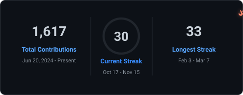
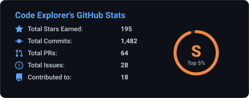
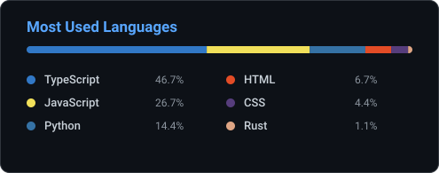
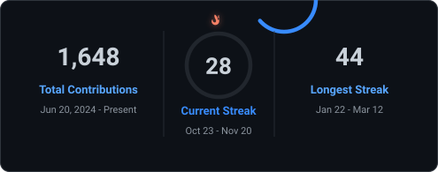
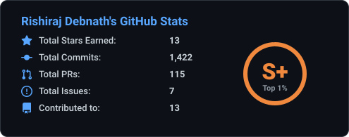
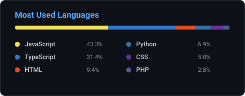

# ⚡ GitHub Stats & Streak Cards (Zero-Downtime Edition)

> **Say goodbye to broken images and dropped streaks.**  
> A high-performance, timezone-accurate, and 100% reliable GitHub Streak & Stats card generator designed specifically for GitHub Profile READMEs.

<p align="center">
  
</p>
<p align="center">
  
  
</p>

---

## 🧐 Why Did Your Old GitHub Stats Break?

If you've used tools like `github-readme-stats` or `github-readme-streak-stats`, you have likely encountered two major issues:

### 1. The Dreaded Broken Image Icon (`Not Available` / 504 / 429)
GitHub profile README images are routed through **GitHub Camo** (a caching image proxy). Camo has a strict **~4-second timeout**. When millions of developers hit public shared instances on free-tier hosting (Vercel/Heroku), GitHub's GraphQL API rate limit (5,000 req/hr shared by everyone) gets exhausted in minutes. Camo times out or receives a `429 Too Many Requests`, and GitHub displays a broken image.

### 2. The Dropped Streak Bug (Showing 11 days when you have 30+ days)
- **Timezone Mismatch:** Traditional tools calculate dates in UTC. If you commit in India (`UTC+5:30`) or the Americas (`UTC-8`), your local day boundary does not match UTC. Committing late at night or early morning can get counted into the wrong day bucket, breaking your streak.
- **The "Today" Flaw:** If you haven't committed *yet today*, naive algorithms assume your streak is 0 or stopped yesterday. In reality, today is still in progress! As long as you committed yesterday, your streak is **active and preserved**.
- **Private Contributions:** Third-party public servers cannot see your private contributions unless granted private access tokens.

---

## 💡 How This Project Solves It

This project provides a **Dual-Mode Architecture**:

| Feature | 🛡️ Mode A: GitHub Action (Recommended) | 🌐 Mode B: Web API / Vercel |
| :--- | :--- | :--- |
| **Uptime** | **100% Guaranteed** (Hosted directly on GitHub CDN) | High (Edge cached + Stale-while-revalidate) |
| **Rate Limits** | **Zero shared limits** (Uses your repo's private `GITHUB_TOKEN`) | Dedicated or rotated API tokens |
| **Camo Timeout** | **Impossible** (Files are static SVGs in your repository) | Protected by fallback SVG generator |
| **Timezone Support** | Full `Intl` Timezone accuracy (`Asia/Kolkata`, `UTC`, etc.) | Supported via `&timezone=` query parameter |
| **Private Commits** | Fully supported | Supported via personal access token |

---

## 🚀 Setup Guide

### 🌟 Mode A: 100% Zero-Downtime GitHub Action (Recommended)

This mode runs automatically every 6 hours (or whenever you push), generates fresh SVGs, and commits them to your repository. **It never goes down, never times out, and costs $0.**

#### Step 1: Create the workflow file
In your profile repository (e.g., `username/username` or this repository), create a file at `.github/workflows/update-stats.yml`:

```yaml
name: Update GitHub Stats Cards

on:
  schedule:
    - cron: '0 */6 * * *' # Updates every 6 hours
  workflow_dispatch: # Allows manual trigger anytime from the Actions tab

permissions:
  contents: write

jobs:
  update-stats:
    runs-on: ubuntu-latest
    steps:
      - name: Checkout repository
        uses: actions/checkout@v4

      - name: Set up Node.js
        uses: actions/setup-node@v4
        with:
          node-version: 22

      - name: Generate Stats Cards
        run: |
          npx github-stats \
            --username "${{ github.repository_owner }}" \
            --timezone "Asia/Kolkata" \
            --theme "github-dark" \
            --output "./stats"
        env:
          GITHUB_TOKEN: ${{ secrets.GITHUB_TOKEN }}

      - name: Commit and Push
        run: |
          git config --global user.name "github-actions[bot]"
          git config --global user.email "github-actions[bot]@users.noreply.github.com"
          git add stats/
          git commit -m "Update GitHub stats cards [skip ci]" || exit 0
          git push
```

#### Step 2: Add to your Profile `README.md`
Add the relative links to your README:

```markdown
<p align="center">
  
</p>
<p align="center">
  
  
</p>
```

*(If you are hosting the workflow in a dedicated repository, use the raw link: `https://raw.githubusercontent.com/<username>/<repo>/main/stats/streak.svg`)*

---

### 🌐 Mode B: Dynamic Web API / Self-Hosting

If you prefer dynamic image URLs or want to host a public instance for yourself and your friends:

#### 1-Click Run Locally / Dev Server:
```bash
# 1. Clone the repository
git clone https://github.com/your-username/Github-Stats.git
cd Github-Stats

# 2. Install dependencies
npm install

# 3. Create .env file with your GitHub token
cp .env.example .env
# Fill in GITHUB_TOKEN=ghp_your_token_here

# 4. Start dev server & interactive web preview
npm run dev
```

Open `http://localhost:3000` in your browser to access the **Interactive Web Preview Playground**!

#### Available API Endpoints:
- **Streak Card:**
  `GET /api/streak?username=YOUR_USER&timezone=Asia/Kolkata&theme=github-dark`
- **Overall Stats Card:**
  `GET /api/stats?username=YOUR_USER&theme=github-dark`
- **Top Languages Card:**
  `GET /api/languages?username=YOUR_USER&theme=github-dark&limit=6`

---

## 🎨 Themes Available

Switch themes by passing `--theme <name>` in CLI or `&theme=<name>` in URL:

| Theme Name | Description |
| :--- | :--- |
| `github-dark` | Classic sleek GitHub dark mode |
| `tokyonight` | Vibrant indigo and cyan night theme |
| `dracula` | Popular purple, pink, and yellow dark theme |
| `nord` | Arctic cool blue-gray palette |
| `cyberpunk` | High-contrast neon yellow and cyan |
| `radical` | Synthwave 80s pink, purple, and green |
| `catppuccin` | Warm pastel mocha aesthetic |
| `one-dark` | Atom classic one-dark |
| `github-light` | Clean crisp white light mode |
| `high-contrast` | Pitch black with pure neon accents |

---

## ⚙️ Customization Options

| Option | CLI Flag | Web Query Param | Default | Description |
| :--- | :--- | :--- | :--- | :--- |
| **Username** | `--username` / `-u` | `?username=` | *(Required)* | GitHub username |
| **Timezone** | `--timezone` / `-tz`| `?timezone=` | `UTC` | Your IANA timezone (`Asia/Kolkata`, `America/New_York`, etc.) |
| **Theme** | `--theme` / `-t` | `?theme=` | `github-dark`| Card color palette |
| **Hide Border** | `--hide-border` | `?hide_border=true` | `false` | Remove outer card stroke |
| **Border Radius** | `--border-radius` | `?border_radius=` | `10` | Corner roundness in pixels |
| **Hide Title** | `--hide-title` | `?hide_title=true` | `false` | Hide header title on cards |
| **Hide Rank** | `--hide-rank` | `?hide_rank=true` | `false` | Hide rank badge on stats card |
| **Language Limit** | `--limit` | `?limit=6` | `6` | Number of top languages to display |

---

## 🧪 Testing

Run the timezone and streak algorithm test suite:

```bash
npm test
```

All streak rollover, timezone offset, and grace period calculations are validated against automated unit tests.

---

## 📄 License

MIT License © 2024. Open source and built for the community.
