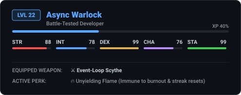
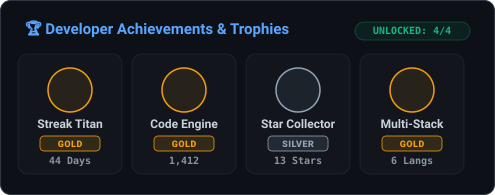
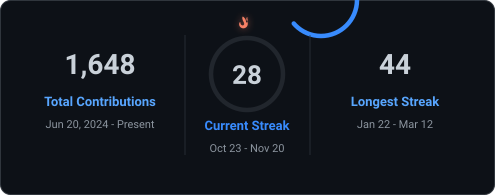
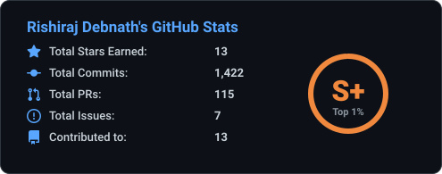
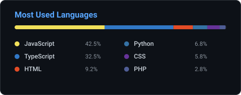

# 🚀 GitHub Suite (by [@13507-IN](https://github.com/13507-IN))

> A curated collection of high-performance tools, cards, widgets, and visual utilities to boost your GitHub experience and supercharge your Profile README.

---

<p align="center">
  
</p>

---

## 📦 Products in this Repository

| Product | Folder | Description | Status |
| :--- | :--- | :--- | :--- |
| **🖼️ Profile Header Banner** | [`/Github-Stats`](./Github-Stats) | Dynamic animated SVG developer console banner with live metrics. | ✅ **Active** |
| **🎮 RPG Developer Card** | [`/Github-Stats`](./Github-Stats) | Gamified developer character sheet with classes, levels, and stat attributes. | ✅ **Active** |
| **💰 Account Worth / Valuation** | [`/Github-Stats`](./Github-Stats) | Calculates estimated commercial engineering value & market tier. | ✅ **Active** |
| **🏆 Achievements & Trophies** | [`/Github-Stats`](./Github-Stats) | Gamified milestone medals based on real commits, streaks, and stars. | ✅ **Active** |
| **🔥 Streak & Stats Cards** | [`/Github-Stats`](./Github-Stats) | Timezone-accurate, 100% zero-downtime streak and stats cards. | ✅ **Active** |
| **🎨 Tech Stack Badges & Dividers** | [`/Github-Images`](./Github-Images) | Dynamic SVG tech stack badges grid and animated wave dividers. | ✅ **Active** |

---

## 🎮 The Full Card Suite

<p align="center">
  
  
</p>
<p align="center">
  
  
</p>
<p align="center">
  
  
</p>

---

## 🖼️ Tech Stack & Section Dividers (Github-Images)

<p align="center">
  
</p>
<p align="center">
  
</p>

---

### Key Highlights:
- **🖼️ Animated Profile Header Banner**: Sleek macOS terminal header featuring live status (`🟢 BUILDING IN PUBLIC`), top skills, streak counter, and commit summary.
- **🎮 RPG Character Sheet**: Determines your character class (*TypeScript Spellblade, Async Warlock, Data Necromancer, etc.*), computes your Level & XP, and scores your STR, INT, DEX, CHA, and STA attributes!
- **💰 Account Valuation Engine**: Evaluates commit volume, repository architecture, star equity, and consistency multipliers into an estimated commercial dev net worth (*e.g. $86,550 - Principal / Staff Architect Tier*).
- **🏆 Milestone Trophies**: Automatically unlocks Bronze, Silver, Gold, Diamond, and Mythic medals based on your actual achievements.
- **🌐 3D WebGL Web Playground**: Built with Three.js particle constellation, interactive 3D holographic wireframe core, 3D perspective tilt cards, Web Audio SFX synthesizer, and 2x Retina PNG exporter.
- **100% Zero Downtime**: Served directly by GitHub's CDN via GitHub Actions or high-speed edge API.
- **Timezone Accurate & Grace Period**: Calculates streaks in your exact timezone (`Asia/Kolkata`, `UTC`, `America/New_York`, etc.) with `--grace-days 1` protection.
- **15+ Themes**: `github-dark`, `tokyonight`, `dracula`, `nord`, `cyberpunk`, `radical`, `catppuccin`, `synthwave`, and more.

👉 **[Read full GitHub-Stats documentation & setup guide →](./Github-Stats/README.md)**  
👉 **[Read full GitHub-Images documentation & setup guide →](./Github-Images/README.md)**

---

### 🛡️ Quick Start: How to use the GitHub Action in your own profile

In your profile repository, create `.github/workflows/update-stats.yml`:

```yaml
name: Update Profile Stats & RPG Cards

on:
  schedule:
    - cron: '0 */2 * * *' # Automatically runs every 2 hours
  push:
    branches: [ main ]
  workflow_dispatch:

permissions:
  contents: write

jobs:
  update-stats:
    runs-on: ubuntu-latest
    steps:
      - uses: actions/checkout@v4

      # Uses the action from this monorepo!
      - uses: 13507-IN/Github-Trash/Github-Stats@main
        with:
          username: ${{ github.repository_owner }}
          timezone: Asia/Kolkata
          grace_days: 1
          theme: github-dark
          output: ./stats

      - name: Commit and Push
        run: |
          git config --global user.name "github-actions[bot]"
          git config --global user.email "github-actions[bot]@users.noreply.github.com"
          git add stats/
          git commit -m "Update profile cards [skip ci]" || exit 0
          git push
```

And in your Profile `README.md`, simply embed them:

```markdown
<picture>
  <source media="(prefers-color-scheme: dark)" srcset="https://raw.githubusercontent.com/13507-IN/Github-Trash/main/Github-Stats/user-stats/banner.svg">
  <source media="(prefers-color-scheme: light)" srcset="https://raw.githubusercontent.com/13507-IN/Github-Trash/main/Github-Stats/user-stats/banner.svg">
  
</picture>

<div align="center">
  
  
</div>

<div align="center">
  
  
</div>
```

---

<p align="center">
  Crafted with ❤️ by <a href="https://github.com/13507-IN">Rishiraj Debnath (@13507-IN)</a>
</p>
